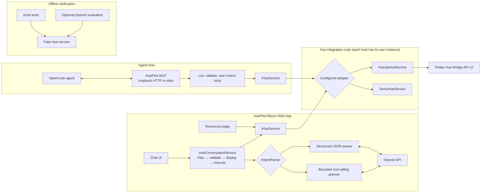

# HuePilot

HuePilot is a .NET 10 Blazor learning project for AI-assisted development and in-app AI. It provides a chat-first interface for Philips Hue, a resources browser, and a local MCP server for compatible agents.

## Repository layout

```text
src/HuePilot/               Blazor application and Hue/OpenAI integrations
src/HuePilot.Mcp/            MCP tools for Hue resources and controls
src/HuePilot.Tests/          Offline unit tests with fakes
src/HuePilot.Eval/           Optional live OpenAI intent evaluation
docs/                       Requirements, architecture decisions, and guides
src/HuePilot.sln             All .NET projects
```

## Architecture



The model proposes; HuePilot resolves discovered resources and validates every action before execution. The MCP server exposes the same bounded Hue service to external agents, with OpenCode approval required for mutations.

## Run the app

```sh
dotnet run --project src/HuePilot/HuePilot.csproj
```

Visit `/setup` to discover and pair a Hue Bridge. Save the IP address and generated application key using the `dotnet user-secrets` commands shown on that page. Add the OpenAI key with:

```sh
dotnet user-secrets set "OpenAI:ApiKey" "<your-key>" --project src/HuePilot/HuePilot.csproj
```

Without Bridge secrets, the app uses clearly labeled demo resources. Browse rooms, lights, scenes, and their room/zone associations at `/resources`.

## MCP server for OpenCode

On macOS, start the loopback-only HTTP MCP server from Terminal so the .NET process has Hue LAN access:

```sh
dotnet run --project src/HuePilot.Mcp/HuePilot.Mcp.csproj -- --http
```

Leave it running while using OpenCode. Project-local configuration is in `.opencode/opencode.json`; write tools require approval. See [`docs/mcp-server.md`](docs/mcp-server.md).

## Build and test

```sh
dotnet build src/HuePilot.sln
dotnet test src/HuePilot.sln
```

The regular test suite uses fakes and does not require a Bridge or live AI service. For optional live-model evaluation (OpenAI usage may incur charges):

```sh
dotnet run --project src/HuePilot.Eval/HuePilot.Eval.csproj -- structured
dotnet run --project src/HuePilot.Eval/HuePilot.Eval.csproj -- tools
```

## Guides

- [Requirements](docs/requirements.md)
- [Architecture decision](docs/decisions/0001-initial-architecture.md)
- [AI approach comparison](docs/ai-approaches.md)
- [AI evaluation](docs/ai-evaluation.md)
- [MCP server](docs/mcp-server.md)

Keep Bridge and OpenAI credentials in local user secrets or environment configuration. Never commit credentials or expose the Hue Bridge API key to browser code or AI tools.
