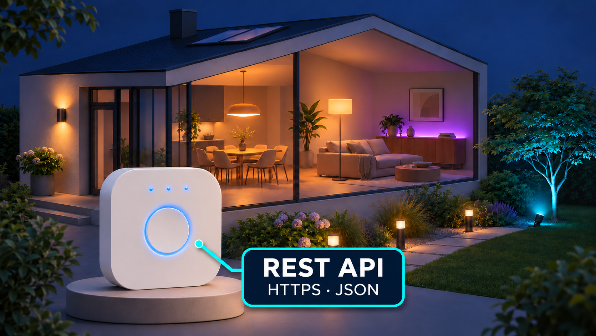
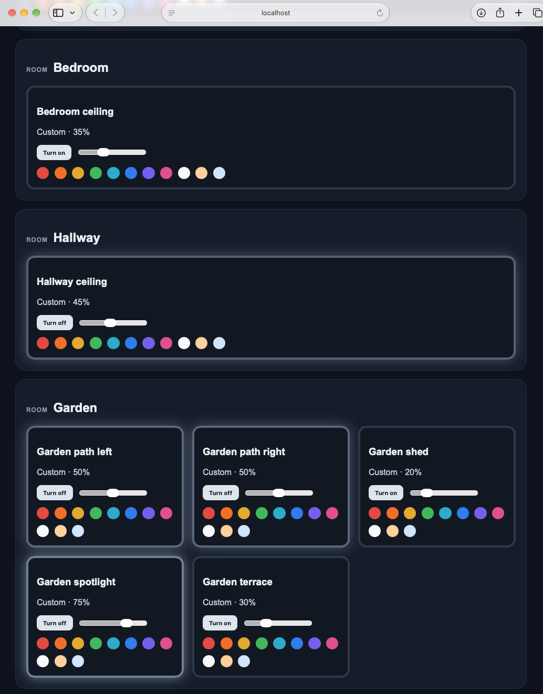
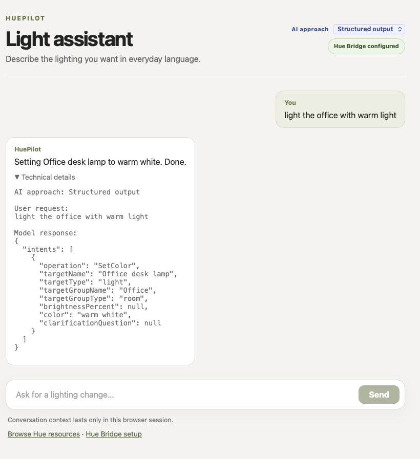

<!-- _class: cover -->

# HuePilot

## Ein Beispiel für sichere Integration von KI in eine Anwendung

Stefan Rebsamen, Noser Engineering Bern

---
# Agenda

- Einführung Philips Hue und Hue Pilot
- Erster Ansatz: Strukturierte Ausgaben: Katalog rein, Absicht raus
- Zweiter Ansatz: Tool-Calling: entdecken, dann vorschlagen
- Allgemeiner Integraion mittels MCP


---
# Philipps Hue: Übersicht



---
# Phlipps Hue: Bridge

Fungiert als Zentrale eines Hue Setups 

- kommuniziert mittels Zigbee Mesh drahtlos mit den Lichtern
- stellt Cloud-Integration bereit
- läss sich mit diversen Apps verbinden
- bietet ein REST Interface

---
# HuePilot: Bridge Simulator

<div class="text-image">
  <div>

Für Demonstrationszwecke

- Simuliert eine Bridge
- Anzeige und Steuerung von Lichtern über eine Website
- Bietet dasselbe REST API (zumindest was wie benötigen)

  </div>
  <div>



  </div>
</div>

---
# Hue Pilot

<div class="text-image">
  <div>

- Blazor-Applikation, um zuhause via Text-Eingaben die Lichter anzusteuern
- privates 'Bastelprojekt' und Spielwiese, *nicht für produktiven Einsatz gedacht*
- grössenteils duch KI generiert
- verwendet OpenAI gpt-4.1-mini als LLM

  </div>
  <div>



  </div>
</div>


---
# Grundsatz für KI Integration

<div class="callout">

Das Modell schlägt eine Absicht vor. Vertrauenswürdiger Anwendungs-Code autorisiert die Ausführung.

</div>

<div class="flow">
Benutzeranfrage
    │
    ▼
KI-Parser ─────► nicht vertrauenswürdiges HueIntent
                      │
                      ▼
              Ressourcen entdecken + auflösen
                      │
                      ▼
            HueActionValidator (Typ / Wert / Operation)
                      │
                      ▼
             ausführbare HueAction ───► IHueService ───► Bridge
</div>


<!-- Notes (1:00): Das ist die einzige Architekturdiagramm, die wir brauchen. Betonen Sie, dass sowohl KI-Ansätze als auch der MCP-Server an derselben vertrauenswürdigen Grenze zusammenlaufen. -->

---

# Was hier „sicher“ bedeutet

| Modell-Ausgabe kann… | HuePilot muss… |
| --- | --- |
| syntaktisch gültig, aber semantisch falsch sein | das Ziel anhand der aktuellen Ermittlung auflösen |
| einen erfundenen Namen oder eine ID enthalten | ablehnen; nicht raten oder ersetzen |
| mehrdeutig sein | eine Rückfrage stellen |
| eine nicht unterstützte Operation oder einen nicht unterstützten Wert enthalten | eine Operation, einen Typ, einen Bereich und eine Farb-Whitelist erzwingen |
| eine Mehrfachaktion enthalten | jede vorgeschlagene Aktion unabhängig validieren |

**Ein JSON-Schema ist ein Vertrag über die Form – keine Autorisierung zur Steuerung von Geräten.**


<!-- Notes (1:30): Verknüpfen Sie dies mit konkreten Prüfungen: Helligkeit 1–100, erlaubte Farbnamen, Szenen nur aktivieren und Status nur für Licht/Raum/Zone. -->

---

# Eine Domänengrenze, drei Aufrufer

<div class="flow">
 Blazor-Chat-UI                 MCP-Client
      │                             │
      ▼                             ▼
 Strukturierter Parser / Tool-Parser   HueMcpTools
      │                             │
      └─────────────┬───────────────┘
                    ▼
       Ressourcen-Ermittlung + HueActionValidator
                    ▼
              IHueService → Hue Bridge
</div>

- `IIntentParser` hält die UI unabhängig von der gewählten KI-Methode.
- `IHueService` hält den Bridge-Zugriff hinter einer anwendungs-eigenen Vereinbarung.
- Die Sicherheitslage ist gemeinsam; **die Modell-/Provider-Oberfläche ist austauschbar**.


<!-- Notes (2:00): Nennen Sie nur die Interfaces, um die Integrationsnaht konkret zu machen. Verbringen Sie keine Zeit mit Blazor-Komponenten oder Transportmechaniken. -->

---

<!-- _class: lead -->

# Ansatz 1

## Strukturierte Ausgaben: Katalog rein, Absicht raus


<!-- Notes (0:15): Übergang: Das ist der Ansatz mit weniger Interaktion. -->

---

# Vertrag für strukturierte Ausgaben

Der Parser sendet:

1. Eine System-Message, die unterstützte Operationen und das Rückfrageverhalten definiert.
2. Kürzlichen Chat-Kontext (bis zu 12 Runden).
3. Einen serialisierten Katalog der aktuell ermittelten Ressourcen und Gruppenbeziehungen.
4. Die jüngste Benutzeranfrage.

Das gewünschte Modell-Kontingent ist ein JSON-Objekt mit einem Array `intents`.

```json
{
  "intents": [{
    "operation": "SetBrightness",
    "targetName": "Desk Lamp",
    "targetType": "light",
    "brightnessPercent": 40,
    "color": null,
    "clarificationQuestion": null
  }]
}
```


<!-- Notes (1:45): Der Ressourcen-Katalog ist eine explizite Grounding-Technik. Er verhindert, dass ein Modell die Wohnung des Nutzers kennen muss, aber er darf nicht als Autorität vertraut werden. -->

---

# Was strukturierte Ausgaben uns bringen

<div class="flow">
entdeckter Katalog + Anfrage
             │
             ▼
      eine Modellbeantwortung
             │  JSON-Modus
             ▼
      deserialisiere HueIntent(s)
             │
             ▼
  in der Anwendung auflösen + validieren
</div>

- **Ein Roundtrip** im normalen Pfad.
- Ein stabiler, prüfbarer DTO-Vertrag (`HueIntent`).
- Einfache Telemetrie: eine Anfrage, eine Modellantwort.
- Funktioniert gut, wenn der Ressourcen-Katalog klein genug ist, um im Kontext mitgeliefert zu werden.


<!-- Notes (1:30): Das ist für einen begrenzten Anwendungsbereich attraktiv. Beachten Sie, dass JSON-Modus nur gültiges JSON garantiert; der Parser akzeptiert außerdem noch ein einzelnes Intent-Objekt als Kompatibilitätsfallback. -->

---

# Was es uns *nicht* bringt

```text
Gültiges JSON ≠ gültige Aktion

{ "targetName": "Kitchen", "operation": "ActivateScene" }
```

Mögliche Probleme trotz gültigen JSON:

- `Kitchen` kann ein Raum sein, kein vorhandenes Szenario.
- Zwei Ressourcen können denselben Anzeigenamen teilen.
- Der Katalog kann sich seit dem Aufbau der Prompt geändert haben.
- Eine Farbe oder Helligkeit kann außerhalb des unterstützten Sets/Bereichs liegen.

<div class="callout">HuePilot löst Namen auf und validiert die daraus resultierende Absicht erneut; es führt deserialisiertes JSON nie direkt aus.</div>


<!-- Notes (1:45): Das ist der zentrale Sicherheitspunkt für strukturierte Ausgaben. Der Code-Kommentar sagt es direkt: JSON-Modus garantiert Syntax, nicht sichere Semantik. -->

---

# Fehlerpolitik bei strukturierten Ausgaben

| Bedingung | Erwartetes Verhalten |
| --- | --- |
| Modell kann ein Ziel nicht identifizieren | Rückfrage stellen |
| Anfrage verwendet eine nicht unterstützte Aktion | klären; niemals improvisieren |
| doppelte Ressourcennamen | passende Treffer benennen und nach Raum/Gruppe fragen |
| ungültige Helligkeit oder Farbe | mit einer nutzerlesbaren Einschränkung ablehnen |
| kein konfigurierter Provider-Key | serverseitig fehlschlagen; kein Key wird an den Browser gesendet |

**Designentscheidung:** Unsicherheit für den Nutzer sichtbar machen, statt eine „best effort“-Änderung in ihrem Zuhause vorzunehmen.


<!-- Notes (1:45): Nennen Sie ein konkretes Mehrdeutigkeitsbeispiel: zwei „Desk“-Lichter. Erwähnen Sie, dass die Parser-Prompt anweist, niemals Ressourcennamen oder Zuordnungen zu erfinden, aber die Anwendung die Richtlinie durchsetzt. -->

---

## Wann strukturierte Ausgaben passend sind

- Das Aktionsvokabular ist klein und stabil.
- Sie können einen kompakten Ressourcen-Katalog pro Anfrage senden.
- Eine einzelne Anfrage-zu-Absicht-Transformation reicht aus.
- Sie wollen einen schnellen, einfachen Pfad mit geringer Komplexität.

<div class="callout">

Wählen Sie diesen Ansatz, wenn die **Anwendung bereits den Kontext hat**, den das Modell für einen begrenzten Vorschlag braucht.

</div>


<!-- Notes (3:00): Nehmen Sie sich hier Zeit für den Trade-off, nicht für die Mechanik. Die Schwäche liegt in Kontextgröße und Aktualität der Namenauflösung; sie ist nicht per se unsicher, solange die serverseitige Validierung zwingend bleibt. -->

---

<!-- _class: lead -->

# Ansatz 2

## Tool-Calling: entdecken, dann vorschlagen


<!-- Notes (0:15): Übergang zum agentischeren Ansatz. -->

---

## Das Modell erhält nur zwei Anwendungstools

| Tool | Zweck | Seiteneffekt |
| --- | --- | --- |
| `lookup_resources` | sucht im serverseitigen aktuellen Katalog nach Namen/Typ/Gruppe | keiner |
| `propose_hue_action` | schlägt eine Steuerung, einen Status oder eine Ressourcenliste vor | **keiner** |

Die Tool-Schemas begrenzen:

- Operation-Enum und akzeptierte Zieltypen
- erforderliche Felder und `additionalProperties: false`
- Typ der Helligkeit und Form des Farbfelds

Die Anwendung – nicht das Schema – prüft vorgeschlagene Ressourcendetails gegen den gelieferten Katalog.


<!-- Notes (1:30): Der Schlüsselunterschied: Tools sind ein Interaktionsprotokoll, keine direkte Steuerungsfähigkeit. Das Vorschlags-Tool ist bewusst nicht mutierend. -->

---

## Eine begrenzte Agentenschleife

<div class="flow">
Anfrage
  │
  ▼
Modell ── lookup_resources ──► Server durchsucht aktuellen Katalog
  ▲                                  │ genaue IDs + Gruppen
  │                                  ▼
  └──────────── Tool-Ergebnis ─────────┘
  │
  ├─ propose_hue_action ──► parse + validiere Vorschlag
  │
  └─ Klartextfrage ──► frage zurück

maximale Modellrunden: 8
</div>

- Parallele Tool-Aufrufe sind für zusammengesetzte Anfragen zulässig.
- Die Schleife kann keine beliebigen Funktionen aufrufen und auch nicht unendlich laufen.


<!-- Notes (2:00): Heben Sie die Obergrenze von acht Runden hervor. Es ist ein operatives Sicherheitsmerkmal ebenso wie ein Kosten-/Latenz-Guardrail. -->

---

## Verankerung mit opaken IDs: das beabsichtigte Protokoll

```text
lookup_resources("Desk", "light", "Office")
        ↓
[{ id: "…", name: "Desk", type: "light", groups: ["Office"] }]
        ↓
propose_hue_action(targetId: "…", operation: "TurnOn")
```

- Die Prompt-Anweisung sagt dem Modell, nur IDs zu verwenden, die **in der aktuellen Anfrage** zurückgegeben wurden.
- Die Anwendung löst ein ID-/Namenspaar gegen den bereitgestellten Ressourcen-Katalog auf und verwirft Mehrdeutigkeit.
- Gruppenfilter disambiguieren doppelte Namen.
- Der aktuelle Parser hat außerdem einen Fallback mit eindeutigen Namen; eine reine IDs-Policy müsste diesen Fallback entfernen.


<!-- Notes (2:00): Opaque IDs senken das Risiko von Namensabgleich ohne das Modell zur Autorität zu machen. Die Bedingung „nur in der aktuellen Anfrage“ schützt vor veralteten Gesprächsverweisen. -->

---

## Zusammengesetzte Anfragen bleiben explizit

> „Schalte Desk und Pinboard ein.“

Die Prompt-Anweisung richtet das Modell an zu:

1. Jede benannte Ressource zu suchen.
2. `propose_hue_action` einmal pro Ziel aufzurufen – ggf. in einer parallelen Tool-Call-Antwort.
3. Die Planung zu beenden; kein Ziel stillschweigend auszulassen.

HuePilot kombiniert gültige Vorschläge und validiert danach jede daraus resultierende Aktion, bevor eine Ausführung erfolgt.

<div class="callout">Mehrere Aktionen sind kein Grund, die Validierung pro Aktion zu schwächen.</div>


<!-- Notes (1:45): Genau hier zahlt sich Tool-Calling gegenüber einem einzelnen generierten Objekt aus: Das Modell kann genau das abfragen, was es braucht, und seine Arbeit zeigen. -->

---

## Tool-Calling endet trotzdem an derselben Schranke

<div class="flow">
Tool-Argumente
   │
   ▼
ParseProposal
   │  löst ID/Namen innerhalb des gelieferten Katalogs auf;
   │  prüft eine gelieferte Gruppenbeziehung
   ▼
HueIntent
   │
   ▼
HueActionValidator
   │
   ▼
Vorschlag im UI angezeigt → separater Ausführungsaufruf
</div>

Der Parser akzeptiert einen **Vorschlag**, keine Nebenwirkung. Die aktuelle UI rendert diesen Vorschlag, bevor sie die Ausführung aufruft, bietet aber noch keinen expliziten Bestätigungs-Gate an.


<!-- Notes (2:00): Trennen Sie die Tool-Schema-Validierung von der Geschäftslogik. Die App prüft die Beziehung zwischen ID/Name/Typ und führt den gemeinsamen Validator aus, bevor sie eine ausführbare Aktion erzeugt. -->

---

## Wann Tool-Calling die richtige Wahl ist

- Der Katalog ist groß, dynamisch oder zu teuer, um ihn in jeden Prompt zu packen.
- Anfragen benötigen mehrstufige Ressourcen-Ermittlung und Gruppen-Disambiguierung.
- Sie schätzen eine nachvollziehbare Spur aus Lookup- und Proposal-Aufrufen.
- Zusätzliche Modellrunden und Latenz sind akzeptabel.

<div class="callout">

Wählen Sie diesen Ansatz, wenn das Modell **kontextuelle Informationen von der Anwendung anfragen muss**, aber nie Autorität zur Ausführung benötigt.

</div>


<!-- Notes (1:30): Benennen Sie den Trade-off: bessere inkrementelle Grounding und Beobachtbarkeit auf Kosten von mehr Runden, Prompts und Orchestrierung. -->

---

## Die beiden Ansätze sind keine Konkurrenten in der Sicherheit

| Dimension | Strukturierte Ausgaben | Tool-Calling |
| --- | --- | --- |
| Modell-Interaktion | eine Abschlussantwort | begrenzte Mehrschritt-Schleife |
| Ressourcen-Grounding | kompletter Katalog im Prompt | gezieltes Laufzeit-Lookup |
| normale Latenz/Kosten | niedriger | höher / variabel |
| Trace | Anfrage + JSON-Antwort | Tool-Call-Transkript + Ergebnisse |
| am besten geeignet für | kompakten, begrenzten Kontext | dynamische Ermittlung und zusammengesetzte Arbeit |
| finale Autorität | Anwendungs-Validator | Anwendungs-Validator |


<!-- Notes (1:45): Vermeiden Sie die Formulierung, Tool-Calling sei „sicherer“. Beide sind nur dann sicher, wenn Ausführung außerhalb des Modells liegt. Die richtige Wahl wird von Kontext und Workflow bestimmt. -->

---

## Selektionsheuristik

```text
Kann die Anwendung alle relevanten Informationen billig bereitstellen?
       │
       ├─ ja → strukturierte Ausgaben sind der einfachere Standard
       │
       └─ nein → Tool-Calling kann nur das abrufen, was nötig ist

In beiden Fällen → aktuelle Ressourcen auflösen + validieren + vor dem Mutieren bestätigen
```

Halten Sie den provider-spezifischen Parser hinter `IIntentParser`; das Ändern der Integration sollte die Sicherheitsgrenze nicht verschieben.


<!-- Notes (1:15): Das ist die Entscheidungsfolie. Bitten Sie das Publikum, auf die Quelle der Wahrheit zu schauen, nicht auf das KI-API-Feature, das „moderner“ wirkt. -->

---

## MCP-Server: separates Host, kein Umgehungspfad

```text
MCP-Client ── HTTP /mcp (zustandslos) ── HueMcpTools
                                            │
                                            ▼
                              frische Ressourcen-Ermittlung
                                            │
                                            ▼
                           HueActionValidator + IHueService
                                            │
                                            ▼
                                      Hue Bridge
```

- Der Server registriert Tools aus seiner Assembly und stellt einen zustandslosen HTTP-Endpunkt unter `/mcp` bereit.
- Bridge-Adresse und Anwendungsschlüssel kommen aus **User Secrets**, niemals aus MCP-Argumenten.
- MCP hat seinen eigenen Host/Prozess, nutzt aber dieselben Domänendienste und Validierungsregeln.
- **Deployment-Hinweis:** Dieser Host konfiguriert keine Authentifizierung oder Autorisierung; betreiben Sie ihn nur hinter einer geeigneten vertrauenswürdigen Netzwerk-/Authentifizierungsgrenze.


<!-- Notes (1:45): Übergang von der In-Process-Integration. Klären Sie den Unterschied zum OpenAI-Tool-Loop: MCP ist ein extern nutzbares Protokoll-Endpoint, kein direkter Tunnel zur Bridge. -->

---

## MCP-Tool-Oberfläche: eng und explizit

| Lesen | Mutierend |
| --- | --- |
| `list_hue_resources` | `set_hue_power` |
| `get_hue_status` | `set_hue_brightness` |
|  | `set_hue_color` |
|  | `activate_hue_scene` |

Muster für Mutationen:

1. Client listet/ermittelt eine aktuelle Ressourcen-ID.
2. Server aktualisiert die Ressourcen vor der Mutation erneut.
3. Server prüft ID-Eindeutigkeit, erlaubten Typ, Szenen-/Gruppenbeziehung und Werte.
4. Der gemeinsame Validator erstellt die Aktion; erst dann ruft `IHueService` Hue auf.


<!-- Notes (1:30): MCP-Clients erhalten einen sicheren Fehler, wenn sie veraltete/nicht vorhandene IDs senden. Das frische Lookup unmittelbar vor der Mutation ist wichtig, weil physische Ressourcen sich ändern können. -->

---

## MCP-Operationen und Beobachtbarkeit

- `McpLoggingMiddleware` zeichnet MCP-Anfrage-/Antwort-Payloads mit einer begrenzten Capturesize auf (standardmäßig 16 KiB).
- Abbruchsignale propagieren an Bridge-Lookup- und Steuerungsaufrufe.
- Bridge-Konnektivitätsfehler geben eine sichere, verständliche Meldung zurück – keine Stacktraces oder Credentials.
- Der Server bietet keine beliebigen URLs, keine Dateisystemzugriffe und kein uneingeschränktes Proxy-Tool an.

<div class="callout">MCP erweitert, wer eine Funktion anfragen kann; es darf nicht erweitern, was diese Funktion tun darf.</div>


<!-- Notes (0:45): Erwähnen Sie, dass Betriebslogging in der Produktion trotzdem respektvoll behandelt werden muss, da Anfragen sensibel sein können. Übertreiben Sie es nicht als komplette Auditlösung. -->

---

<!-- _class: lead -->

# Takeaways

1. **Verankern** Sie KI-Ausgaben in Ressourcen, die Ihre Anwendung selbst ermittelt hat.
2. **Validieren** Sie semantische Absichten serverseitig – Schemas und Tool-Definitionen reichen nicht aus.
3. **Trennen** Sie Vorschlag und Ausführung für jeden Seiteneffekt-Pfad.
4. **Wiederverwenden** Sie eine gemeinsame Domänen-Sicherheitsgrenze für strukturierte Ausgaben, Tool-Calling und MCP.

## Fragen?


<!-- Notes (1:00): Beenden Sie mit der wiederholten architektonischen Invariante: Das Modell kann die Schnittstelle verbessern, aber vertrauenswürdiger Code besitzt die Autorität über die physische Welt. -->
